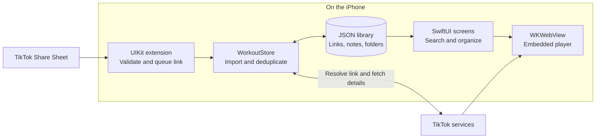
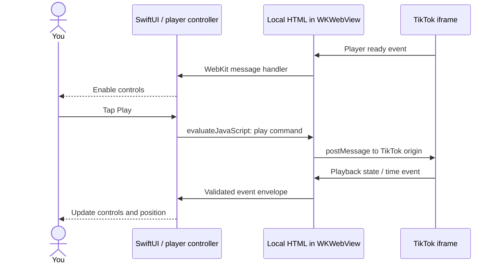
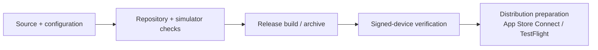

# YARMS implementation catch-up

[Documentation index](README.md) · [Architecture](Architecture.md) · [Repository map](Repository-Map.md)

**YARMS helps you collect TikTok workout links, organize them into folders, and follow along with personal notes on your iPhone.** The MVP is implemented. The library lives locally; TikTok supplies the video and playback. There is no YARMS account or backend.

This is a running learning reference based on the project-catchup visual template: a short orientation, focused walkthroughs, a dated baseline, and an append-only learning/snapshot log. The focused guides remain authoritative for current behavior. This document explains the baseline below; later snapshots must identify what changed.

## At a glance



In words: the extension queues a link in shared Keychain. The app imports it into its own library. Metadata and playback cross the network boundary afterward; saving does not require those requests to succeed.

| Remember | Concrete meaning |
| --- | --- |
| Native app, web playback | SwiftUI builds app screens; UIKit handles sharing; WebKit hosts TikTok's official player. |
| Local-first library | The app stores workout records, not reusable video files. No built-in cross-device sync. |
| Save before enrichment | A title or thumbnail failure does not undo the saved link. |
| Current platform | The Xcode project declares iOS 18.0 minimum and Swift 5 language mode, not a verified installed compiler version. |

Sources: [app entry](../YarmsApp/YarmsApp.swift), [project settings](../Yarms.xcodeproj/project.pbxproj), [architecture](Architecture.md). The normal app build has no third-party package-install step; optional project-generation tooling has separate prerequisites in [Development](Development.md).

## One save: Share Sheet to library

```mermaid
sequenceDiagram
    actor You
    participant Extension as Share extension
    participant Inbox as Shared Keychain
    participant App as YARMS app
    participant Library as Library.json
    participant TikTok as TikTok metadata
    You->>Extension: Share → Save to yarms
    Extension->>Extension: Validate and clean the link
    Extension->>Inbox: Write pending ID, link, save time
    Extension-->>You: Complete only after successful write
    You->>App: Open or return to app
    App->>Inbox: Read pending links
    App->>Library: Atomically save new workout records
    App->>Inbox: Acknowledge imported entries
    App-->>You: Show new workout in Unfiled
    App->>TikTok: Resolve short link; request metadata
    TikTok-->>App: Available title, creator, thumbnail URL
    App->>Library: Persist details and retry state
    App-->>You: Refresh card
```

1. **Validate at the boundary.** `TikTokLink` finds supported HTTPS TikTok video/short links in URL or text input, rejects credentials and explicit ports, and strips query/fragment data. Unsupported input produces an error rather than a queued record. [Parser](../YarmsCore/TikTokLink.swift), [share handler](../YarmsShare/ShareViewController.swift).
2. **Keep capture small.** `KeychainInbox` stores a small pending record; the extension does not download the video or fetch its metadata. Shared Keychain supports the project's free Personal Team setup. Paste and the optional App Intent instead use a file inbox. [Keychain inbox](../YarmsCore/KeychainInbox.swift), [file inbox](../YarmsCore/SharedInbox.swift), [sharing guide](Shortcut-Sharing.md).
3. **Commit, then acknowledge.** `WorkoutStore.refresh()` reads the library and both inbox batches, checks known URLs/video identities, and atomically saves additions before removing pending entries. Failed writes retain the queue. If acknowledgement fails after a save, replay recognizes the existing workout. This is a replay-safe handoff, not a database transaction spanning Keychain and files. [Store](../YarmsApp/WorkoutStore.swift).
4. **Publish current state.** `LibraryShellView` refreshes on appearance and foreground activation. Store operations run through a serial background executor; numbered snapshots prevent stale async results from replacing newer UI state. New captures are Unfiled; a retained search can still hide them. [Library view](../YarmsApp/LibraryShellView.swift).
5. **Enrich independently.** The app resolves short links and calls TikTok's oEmbed endpoint for details. It fills missing fields. If different links resolve to the same video, the store coalesces them, preserving the earliest saved identity and merging details/notes under the documented rules. [Metadata client](../YarmsApp/TikTokMetadataClient.swift), [duplicate rules](Data-and-Privacy.md#restore-and-duplicate-rules).

Metadata work is bounded to **three active workouts** and **five attempts per retry cycle**. Transient failures back off for 1, 2, 4 and 8 minutes; server Retry-After can extend the delay, capped at 24 hours. New requests are scheduled only while the app is active; in-flight work can finish after inactivity. Partial and terminal outcomes stay quiet until an explicit retry reset. This is an app-local queue, not a background service. [Queue](../YarmsApp/WorkoutEnrichmentQueue.swift), [retry state](../YarmsApp/Workout.swift).

## Native controls to web player

**The bridge is a two-way messenger between Swift and JavaScript.** TikTok performs playback; YARMS supplies native play/pause, ±10-second seek and replay controls around it.



An **iframe** is a web page embedded inside another page. YARMS creates the surrounding HTML locally and places the official TikTok player inside it. Swift's `TikTokPlayerController.send()` invokes a JavaScript function; that function forwards the command through `postMessage`. Incoming events travel through `WKScriptMessageHandler` to published Swift properties, which update SwiftUI.

The host checks message origin and the TikTok player marker. Native parsing also requires the host's main frame, a recognized event format, and valid nonnegative finite times. Commands target TikTok's origin and wait for readiness; normal UI controls are disabled on player error. Seeking is clamped to zero and the known duration. These checks narrow accepted messages; they are not a global network sandbox. [Bridge](../YarmsApp/TikTokPlayerBridge.swift), [native player view](../YarmsApp/EmbeddedPlayerView.swift).

The always-available **Open in TikTok** action is the fallback. It cannot recover a deleted or unavailable post. YARMS does not select a bitrate or resolution; playback quality/loading depends on the embedded player and network conditions.

## Storage and caches are different

| Data | Stored where | Lifecycle / implication |
| --- | --- | --- |
| Links, title/creator, thumbnail URL, notes, folders, aliases, retry state | App's `Application Support/Yarms/Library.json` | Small records relative to video files; grows with collection and notes. No measured per-workout size guarantee. |
| Pending shared links | Shared Keychain | Removed after import or duplicate acknowledgement; not the workout library. |
| Paste / App Intent captures | App-local JSON inbox | Removed after successful import or duplicate acknowledgement. |
| Player website data | WebKit's default persistent data store | Can survive player closure/app sessions. No YARMS cleanup schedule or size budget. |
| Thumbnails / network responses | Standard image/network framework behavior | No YARMS-specific cache controller or measured total-storage bound. |
| Exported backup | User-selected Files location | Separate unencrypted JSON copy; deleting a workout does not update old exports. |

YARMS does **not** save a reusable video file. That does not mean its total disk usage equals the JSON file: temporary/cached web resources can use space. Closing the player stops loading and removes its message handler, but does not clear its website data. Long-term cache growth has not been measured in this review. [Storage contract](Data-and-Privacy.md), [player teardown](../YarmsApp/EmbeddedPlayerView.swift), [Apple website data store](https://developer.apple.com/documentation/webkit/wkwebsitedatastore).

### Cache cleanup discussion — proposed, not implemented

| Option discussed | Benefit | Cost / risk |
| --- | --- | --- |
| Manual “Clear playback cache” button | User-controlled space recovery or troubleshooting | Requires discovery and action; no automatic maintenance. |
| Automatic cleanup | No user maintenance | Can discard useful resources, requiring more network data and slower subsequent loading. |
| Both | Automatic maintenance plus manual recovery | More behavior and lifecycle cases to implement and verify. |

The conversation recommendation was to **measure growth and start with manual playback-cache cleanup if needed**, rather than clear after every workout. This is an advisory recommendation, not an approved implementation or a committed roadmap item. Correctly scoped cleanup would leave the separate JSON library and pending inboxes untouched, run when playback is closed, and target cache types rather than all website data. Clearing all website data could reset cookies/session state. Thumbnail/network cache handling would be a separate scope. Apple exposes [disk-cache types](https://developer.apple.com/documentation/webkit/wkwebsitedatatypediskcache) and [typed removal](https://developer.apple.com/documentation/webkit/wkwebsitedatastore/removedata(ofTypes:modifiedSince:completionHandler:)); no storage-saving amount is promised here.

## Implementation choices and their tradeoffs

“Recorded” means existing project documentation states the choice or constraint. “Inferred” identifies an interpretation of the code's benefits, not a claim about historical intent or rejected alternatives.

| Choice | Reason / benefit | Accepted boundary |
| --- | --- | --- |
| Local JSON, no YARMS backend | Recorded architecture; inferred benefit: fewer operational services and straightforward user-owned exports. | Whole-library reads/writes; no app-managed cross-device sync. A database migration is profile-dependent, not scheduled. |
| Shared Keychain instead of former App Group storage | Recorded: supports the owner's free Personal Team sharing setup. | Both targets need aligned signing/access groups; old App Group libraries require export-before-upgrade. |
| Durable capture separate from enrichment | Recorded: saving survives metadata/network failure. | Cards may initially lack details; short links need resolution for inline playback. |
| Official embedded TikTok player | Recorded implementation; inferred benefit: delegate media playback to its provider. | Availability and web-player behavior remain external dependencies; no offline archive. |
| Bounded retries and concurrency | Recorded efficiency work limits repeated requests and active tasks. | Some incomplete details need manual retry; no inactive/background request scheduler. |
| Fresh disk reads plus revisioned snapshots | Recorded: retain visibility of App Intent writes and reject stale UI completions. | No retained library cache; the process lock is not an interprocess database lock. |
| Versioned, validated additive restore | Recorded: keep existing content and merge supported backups. | Restore is not replacement; untrusted thumbnail/alias claims are discarded and details may need refetching. |

Sources: [Architecture](Architecture.md), [Efficiency](Efficiency.md), [Storage migration](Storage-Migration.md), [Data and privacy](Data-and-Privacy.md).

## Engineering concepts in this project

| Concept | Meaning | Concrete YARMS example |
| --- | --- | --- |
| Separation of concerns | Components have distinct jobs. | Capture, persistence, metadata and player messaging have separate implementations. |
| Atomicity and durability | Avoid partial file replacement; preserve completed saves. | Atomic JSON write before queue acknowledgement. This does not provide full database ACID guarantees. |
| Idempotency | Retrying the same input does not repeat its effect. | Replayed pending links and repeated restores avoid duplicate records under identity rules. |
| Concurrency control | Coordinate work that can overlap. | Serial background store executor plus process-wide lock; snapshot revisions reject stale UI results. |
| Sets / dictionaries | Index identities instead of repeatedly scanning growing collections. | Known URL/video checks and restore folder/identity mappings. These improve specific operations, not a guarantee that every operation is constant time. |
| State machine / exponential backoff | Represent outcomes explicitly and wait longer between transient retries. | Persisted enrichment status, attempt count and next-attempt date. |
| Reactive UI | Render from observable state. | Player publishes readiness/time/play state; SwiftUI updates controls. |
| Message passing / protocol validation | Exchange structured commands across a boundary. | Swift ↔ JavaScript ↔ TikTok iframe, with event shape/origin checks. |
| Schema evolution | Support intentional changes to stored formats. | Schema 2 preserves folders; supported schema 1 data has explicit compatibility rules. |
| Defensive programming / trust boundaries | Validate external input before relying on it. | TikTok host/path checks and bounded, sanitized backup import. |
| Regression testing / CI | Recheck important behavior automatically after changes. | Store, redirect, retry, backup and player tests; isolated UI fixtures; repository and Release gates. |

Reading route: [store](../YarmsApp/WorkoutStore.swift) → [workout state](../YarmsApp/Workout.swift) → [bridge](../YarmsApp/TikTokPlayerBridge.swift) → [backup boundary](../YarmsApp/WorkoutBackup.swift). See [Testing](Testing.md) for actual coverage and execution limits.

## Apple frameworks, guidance and release procedures

These are different kinds of rules: platform APIs/capabilities govern integration; Human Interface Guidelines guide usability; signing and distribution procedures govern installation/release. Their use alone does not certify App Store approval, accessibility compliance, or production readiness.

| Area | How it applies here | Reference |
| --- | --- | --- |
| Native frameworks | SwiftUI app, UIKit Share extension, WebKit playback, Foundation networking/JSON and Security Keychain APIs. | [Repository map](Repository-Map.md) |
| Sandbox / Keychain entitlement | App and extension use a matching shared access group. An entitlement is a signed capability declaration. This does not expose the entire app library to the extension. | [Apple Keychain sharing](https://developer.apple.com/documentation/xcode/configuring-keychain-sharing), [app entitlements](../YarmsApp/Yarms.entitlements), [extension entitlements](../YarmsShare/Yarms.entitlements) |
| UI execution and lifecycle | UI updates are coordinated on the main thread; storage runs off it. Foreground activity controls new metadata scheduling. | [Library view](../YarmsApp/LibraryShellView.swift), [store](../YarmsApp/WorkoutStore.swift) |
| Accessibility / HIG | Dynamic Type layouts, VoiceOver labels/focus, adaptive colors and Reduce Motion behavior. Simulator fixtures do not prove live TikTok accessibility. | [Design language](Design-Language.md), [Apple accessibility guidance](https://developer.apple.com/design/human-interface-guidelines/accessibility) |
| Signing / provisioning | Device installation needs valid app and extension signing, appropriate profiles and aligned Keychain identities. Free-team installs need periodic renewal. | [Development](Development.md), [Apple signing workflow](https://help.apple.com/xcode/mac/current/en.lproj/dev60b6fbbc7.html) |
| Release / distribution | Local tooling checks Release configuration and can create archives. CI's unsigned check does not certify device signing. TestFlight/App Store distribution needs the appropriate developer membership and App Store Connect process. | [Release](Release.md), [Apple distribution](https://developer.apple.com/documentation/xcode/distributing-your-app-for-beta-testing-and-releases) |



This is a conceptual release path, not an automatic deployment pipeline. The baseline README documents source installation only, with no App Store/TestFlight release. See [Testing](Testing.md) for signed-device checks and known diagnostics.

## Product and operational limits

- **External availability:** TikTok must keep the post/player available; internet access alone cannot guarantee playback. Metadata can be missing even when the link is saved.
- **Local ownership:** no built-in cross-device sync, account recovery or server copy. Backups are manual, unencrypted JSON. The app adds no encryption layer to its library; iOS protection is a separate concern.
- **Restore size:** at most **10 MiB (10,485,760 bytes)**. Export can exceed that limit and warns; that oversized file cannot currently be restored. A new large-backup format is deferred.
- **Organization/search:** one folder per workout; search covers title, creator and links, not note text or folder names.
- **Notes/completion:** notes require Save notes; keyboard Done only dismisses editing. Finish workout shows a self-reported celebration, not completion history, dates, streaks or tracking.
- **Deletion:** removes the local workout, not the TikTok post or old backups. A later share or restore can add it again.
- **Cache/storage:** no explicit app cache limit or clear-cache feature; total storage growth and real-device playback performance are not measured here.
- **Distribution/verification:** iOS-only source build at this baseline. Local fixture tests do not certify real provider playback, Share Sheet signing, Files providers or human accessibility. The known notes-focus frame diagnostic and iOS-version-specific test limits remain in Testing.

Details: [User guide](User-Guide.md), [Data and privacy](Data-and-Privacy.md), [Efficiency follow-ups](Efficiency.md), [Testing](Testing.md).

## Baseline — November 2, 2026

| Field | Evidence |
| --- | --- |
| Identity | [joshuawyadao/yarms](https://github.com/joshuawyadao/yarms); native iPhone workout-link library. Source root: repository root (`.`); all source links are relative for portability. |
| Review date / zone | November 2, 2026 · America/Los_Angeles. |
| Source baseline | `7ef6825c6f5a3567c1150751fa8c8a367d83e280` on fetched `origin/main`; initial review checkout was detached and clean. Documentation branch: `codex/project-implementation-catchup`, created from that same revision. |
| Comparison | Default last 30 days: October 3–November 2, 2026. No earlier catch-up reference was available in this conversation or the focused project filename search. Older sources were used for enduring design decisions. |
| October 12 change | `371c9e08a39ee3e5cb9263b1ec845da06966f1a1` / [PR #15](https://github.com/joshuawyadao/yarms/pull/15): gentle completion celebration, accessibility/regression work and Release archive tooling. |
| October 28 change | `7ef6825c6f5a3567c1150751fa8c8a367d83e280` / [PR #16](https://github.com/joshuawyadao/yarms/pull/16): batched imports, revisioned/background snapshots, bounded retries and streamlined CI. |
| Historical verification | The October 28 commit message records 119 passing simulator tests, repository/Release checks and completed Codex review. This is recorded evidence at that revision, not a fresh test execution or live deployment observation. Earlier ledgers contain intermediate results and pending states. |
| This catch-up's validation | Source/docs/history inspection; no new simulator, device or playback run. Documentation-change checks and PR readiness are recorded with the implementation plan and PR, separately from product validation. |
| Evidence limits | No production/distribution state was inspected. No long-term cache measurement, cache-cleanup implementation or verified resolution-selection behavior is claimed. |
| Personal contribution | This reference was drafted with Codex assistance from source and conversation. Repository attribution does not establish the user's independent authorship, role or measured impact. |

Some historical text in Efficiency and the prior implementation plan still describes PR #16 as pending/unmerged. The fetched main history already contains its October 28 squash commit. Treat those entries as historical leads, not current PR status; this catch-up does not rewrite their original audit ledger.

### Learning log

| Date | Topic / project example | User-reported understanding | Next question / evidence |
| --- | --- | --- | --- |
| 2026-11-02 | Architecture, save handoff and folders | Said the explanation made sense and summarized YARMS as an organizer/follow-along app. | Future catch-up can start with changes rather than repeat the product overview. |
| 2026-11-02 | Swift / JavaScript / iframe bridge | Said the playback explanation made sense. | Revisit actual bridge messages if playback behavior changes. |
| 2026-11-02 | Stored links versus streamed videos; cache choices | Discussed small library records, variable cache use and manual versus automatic cleanup; said the explanation made sense. | Measure growth before deciding whether to implement cleanup. No cache change was authorized in this discussion. |
| 2026-11-02 | Engineering concepts and Apple procedures | Said they thought they understood how everything works and requested this running reference. This is self-reported understanding, not an assessment. | Compare future changes to these examples; practice/interview work only if requested. |

### Open questions and deferred decisions

| Question | Status / evidence needed |
| --- | --- |
| Does repeated playback cause meaningful persistent storage growth? | Unknown; measure on representative devices and workloads. |
| Should cache cleanup be manual, automatic or both? | Advisory manual-first option discussed; no implementation decision or schedule. |
| When are a database or larger-backup format justified? | Profile-dependent storage work and deferred backup-compatibility design; see Efficiency. |
| What release/device evidence is current at the next review? | Read current CI, signing/profile status and device evidence; never carry forward historical passes as fresh results. |

## How to update this reference

1. Identify the new full source commit, branch, review date/time zone and local changes. Compare with the latest saved source baseline, not the document's own commit hash. If history diverged or is shallow, say so.
2. Recheck changed callers, implementations, tests and canonical guides. Update canonical guides when behavior changes; keep this document's baseline observations dated.
3. Append a dated snapshot below with verified changes, rationale labels, test evidence/limits and learning implications. Preserve the baseline and earlier snapshots; label any refreshed overview with its new as-of revision.
4. Append learning-log entries only for topics actually discussed and statements the user actually made. Carry forward open questions explicitly; do not invent recall scores, ownership or impact metrics.
5. Separate implemented code, local uncommitted work, proposals, and deployed state. Link commits/PRs and source symbols. Keep credentials, real backups, personal collections and private logs out of this public document.

### Snapshot history

| Date | Previous → current source commit | Meaningful change | Learning implication |
| --- | --- | --- | --- |
| 2026-11-02 | No prior saved catch-up → `7ef6825c6f5a3567c1150751fa8c8a367d83e280` | Initial reference created from the conversation and verified source; documentation only. | Foundation covers saving, playback, storage/caches, limitations, engineering concepts and Apple procedures. |

Future entries should include their own verification results and uncertainty. The baseline's historical test counts must remain attached to their original revision.
